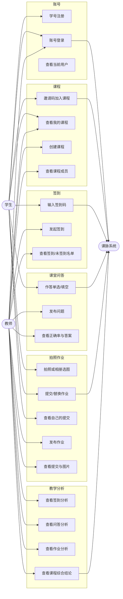
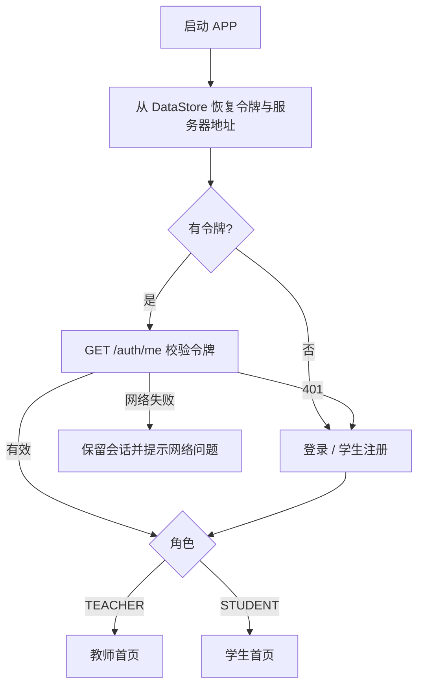
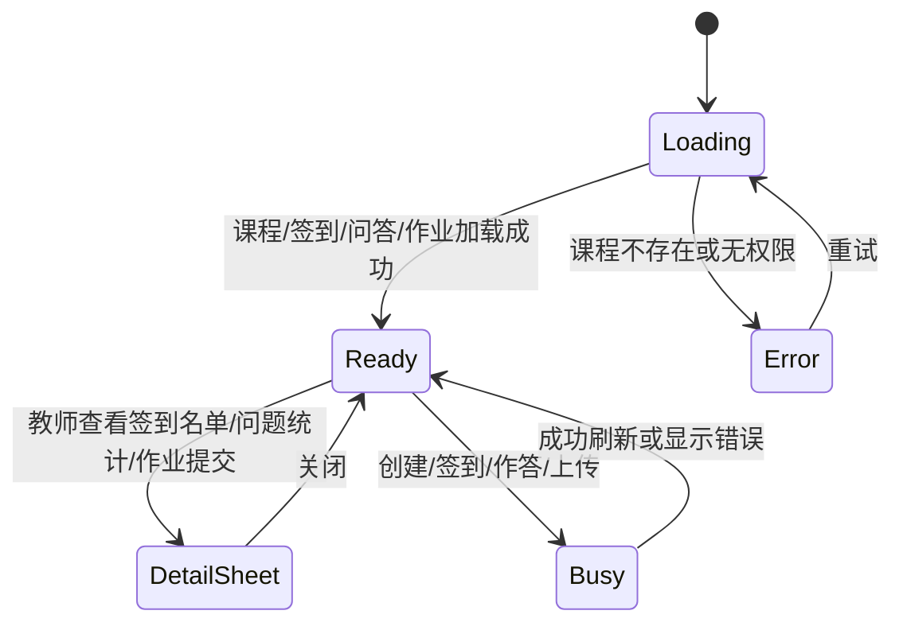

# 需求与设计

## 1. 产品定位

**课脉 Classroom Pulse** 是面向大学课堂的轻量互动教学系统。教师和学生使用同一个 Android 应用，以角色区分工作台；所有课堂活动归属于课程，形成“课程—课堂活动—学生参与—数据分析”的闭环。

设计原则：

1. **一节课一条脉络**：签到、问题、作业都围绕课程聚合，不做跨课程的数据入口。
2. **教师低操作成本**：建课、发起活动都控制在单页弹窗内，签到码和邀请码直接可复制。
3. **学生只看见自己的数据**：问题和作业的私人结果、图片均按所有权隔离。
4. **统计可解释**：每张图明确标注分母，结论从数据库实时查询生成。
5. **可测试性**：核心业务规则由自动化测试覆盖，部署代码不携带预置账号或测试数据。

## 2. 角色与权限

| 能力 | 学生 | 教师 |
| --- | --- | --- |
| 注册账号 | 学号自助注册 | 不开放；环境变量预置 |
| 登录 | 学号 + 密码 | 工号/账号 + 密码 |
| 创建课程 | 禁止 | 仅能创建自己的课程 |
| 加入课程 | 邀请码，只能加入一次 | 不需要加入 |
| 查看课程列表 | 已加入课程 | 自己创建的课程 |
| 查看课程成员 | 禁止 | 自己课程的全部成员 |
| 发起签到 | 禁止 | 自己课程 |
| 签到 | 课程成员 + 6 位码 + 有效期内 + 仅一次 | 查看签到码、名单 |
| 发布问答 | 禁止 | 自己课程 |
| 作答 | 课程成员、截止前、每题一次 | 查看提交人数、正确率、逐人答案 |
| 发布作业 | 禁止 | 自己课程 |
| 提交作业 | 课程成员、截止前、只能看/改自己的提交 | 查看全部提交和图片 |
| 查看教学分析 | 禁止 | 自己课程 |
| 查看他人作业图片 | 禁止 | 仅自己课程 |

权限在服务端执行，Android 端隐藏入口仅用于体验优化，不能作为安全边界。

## 3. 用例图

## 4. 页面流程

### 4.1 全局启动

### 4.2 教师主流程

1. 教师登录 → 首页展示自己创建的全部课程、课程数、选课人次。
2. 创建课程 → 服务端生成 7 位邀请码 → 首页课程卡可复制邀请码。
3. 进入课程 → 顶部展示课程信息与成员数 → 四个页签：签到、问答、作业、分析。
4. 签到页：发起签到（标题 + 有效时长）→ 展示 6 位签到码 → 实时看到已签到人数 → 点击查看已签到/未签到名单。
5. 问答页：发布单选题/填空题 → 设置选项或参考答案及截止时间 → 卡片展示提交人数、正确人数、正确率 → 点击查看选项分布与逐人答案。
6. 作业页：发布作业（标题、说明、截止时间）→ 卡片展示提交率 → 点击查看逐人提交状态和图片缩略图 → 全屏查看原图。
7. 分析页：首次进入自动请求聚合统计 → 展示总体达成、分类指标、图表和自动结论 → 可刷新。

### 4.3 学生主流程

1. 学生注册：学号 + 姓名 + 密码 → 自动登录。
2. 首页 → 输入 7 位邀请码加入课程。
3. 进入课程 → 三个页签：签到、问答、作业。
4. 签到页：进行中的签到卡内输入 6 位签到码 → 成功后状态立即变为“已签到”；截止/重复/错误码均有明确反馈。
5. 问答页：截止前选择选项或填写答案 → 提交后展示正确/错误、个人答案和参考答案；每题只能提交一次。
6. 作业页：点击提交 → 拍照或相册选择 → 可填写说明 → 上传；截止前可替换，卡片展示最新版本缩略图和提交时间。
7. 学生看不到其他学生作业图片，也看不到教师端分析页。

### 4.4 课程详情状态流

## 5. 关键业务规则

### 5.1 账号

- 学号为唯一账号，服务端唯一索引兜底。
- 密码 BCrypt（strength 12）哈希，数据库不保存明文。
- JWT 默认有效期 168 小时，生产密钥由 `JWT_SECRET` 注入；`prod` profile 下缺失密钥启动失败。
- 学生注册接口固定创建 `STUDENT`，不能伪造角色。

### 5.2 签到

- 签到码由 `SecureRandom` 生成，6 位数字，可含前导零。
- 有效期由服务端以 UTC 计算；客户端只负责展示本地时区时间。
- 校验顺序：学生身份 → 课程成员 → 活动有效期 → 签到码 → 是否重复。
- 同一次签到 `(session_id, student_id)` 唯一约束。
- 教师列表返回签到码；学生列表永远不返回签到码，避免提前泄露。
- 签到码只能证明“持码”，不能证明“本人在场”；产品不宣称防止代签。

### 5.3 问答

- 选择题选项 2–6 个，服务端自动生成 A/B/C… 键；正确答案必须是合法选项键。
- 填空题保存单个标准答案。
- 截止判断由服务端执行；客户端截止后隐藏提交入口。
- 每题 `(question_id, student_id)` 唯一。
- 选择题严格比较选项键；填空题 `trim()` 后 `equals(ignoreCase = true)`。
- 正确率分母为**实际提交人数**，不是课程成员数。
- 学生提交前不返回标准答案；提交后返回个人结果与标准答案。

### 5.4 作业

- 每次提交一张图片，格式 JPEG/PNG，最大 10 MB。
- 服务端同时校验声明的 MIME 与文件魔数，不信任扩展名。
- 文件使用 UUID 随机命名，原文件名仅作为元数据保存。
- 每名学生每项作业只有一条提交记录；替换时更新原记录，保留原 `submittedAt`，更新 `updatedAt`。
- 图片只通过受保护的 `GET /api/v1/submissions/{id}/image` 流式返回：
  - 课程教师可看本课程所有提交；
  - 学生只能看自己的提交；
  - 其他教师/学生返回 403；
  - Nginx 对 `/uploads/` 直接返回 404，不能绕过 API。

### 5.5 统计口径

| 指标 | 分子 | 分母 | 说明 |
| --- | --- | --- | --- |
| 签到率 | 实际签到人数 | 当前课程成员数 | 每次签到单独统计 |
| 签到平均值 | 各次签到率之和 | 签到次数 | 等权平均 |
| 问答正确率 | 正确人数 | 实际作答人数 | 未作答不计入分母 |
| 问答题平均正确率 | 各已作答题正确率之和 | 有作答题目数 | 每道有作答题等权；无人作答题目不参与 |
| 作业提交率 | 已提交人数 | 当前课程成员数 | 每项作业单独 |
| 作业平均提交率 | 各项提交率之和 | 作业数 | 每项等权 |
| 综合达成 | 有数据模块均值之和 | 有数据模块数 | 仅统计有数据的模块；问答只取有作答的题目 |

结论文本由服务端根据查询结果拼接，前端不生成、不硬编码统计数值。

## 6. 信息架构与视觉

- **品牌**：课脉 / CLASS PULSE，视觉隐喻“课堂脉冲”。主色墨绿 `#0F5B55`，纸张底色 `#F7F3E8`，珊瑚 `#E86A4A`，金色 `#E9B44C`，深墨 `#142A2E`。
- **排版**：中文标题使用衬线字体，正文使用系统无衬线；卡片圆角 22–30 dp，避免通用蓝白模板感。
- **登录页**：品牌图形 + “让每一次课堂都有迹可循” + 登录/注册切换 + 服务器设置。
- **首页**：深色 hero 卡、课程编号卡、邀请码快捷复制、角色徽章。
- **课程页**：深色课程 hero、四个胶囊页签、横向进度条与列表卡片。
- **统计页**：环形综合达成、三指标 tile、签到柱状图、问答/作业进度条、结论卡、统计口径说明。

## 7. 非功能需求

| 维度 | 要求与实现 |
| --- | --- |
| 安全 | JWT、BCrypt、服务端权限检查、图片所有权校验、上传魔数校验、路径穿越防护 |
| 数据一致性 | 外键、唯一约束、事务、服务端时间、UTC 存储 |
| 可用性 | 统一错误 envelope；网络错误中文提示；加载/空状态/错误状态完整 |
| 性能 | Hikari 连接池；列表聚合查询；图片流式响应；Android 端 Coil 缓存 |
| 可维护性 | 分层结构、Flyway 版本化、API 前缀 `/api/v1`、构建脚本、Docker 化 |
| 隐私 | 学生只能访问自己提交；分析仅教师可见；仓库不包含真实姓名、照片或部署凭据 |
| 可复现 | Gradle Wrapper、Docker Compose、Flyway、自动化测试与构建脚本 |

## 8. 范围边界

**本期包含**：课程、签到、单选/填空问答、单图作业、任课教师分析、JWT 登录、Docker/Nginx 部署配置。

**本期不包含**：推送、实时聊天、定位签到、人脸识别、作业评分、图片多图提交、选课审批、跨课程统计、教师自助注册、密码找回、账号停用/删除。

**默认假设**：服务器可以运行 Docker、开放 80/443；域名已解析到服务器；Redis、对象存储等基础设施不在本期依赖内。

