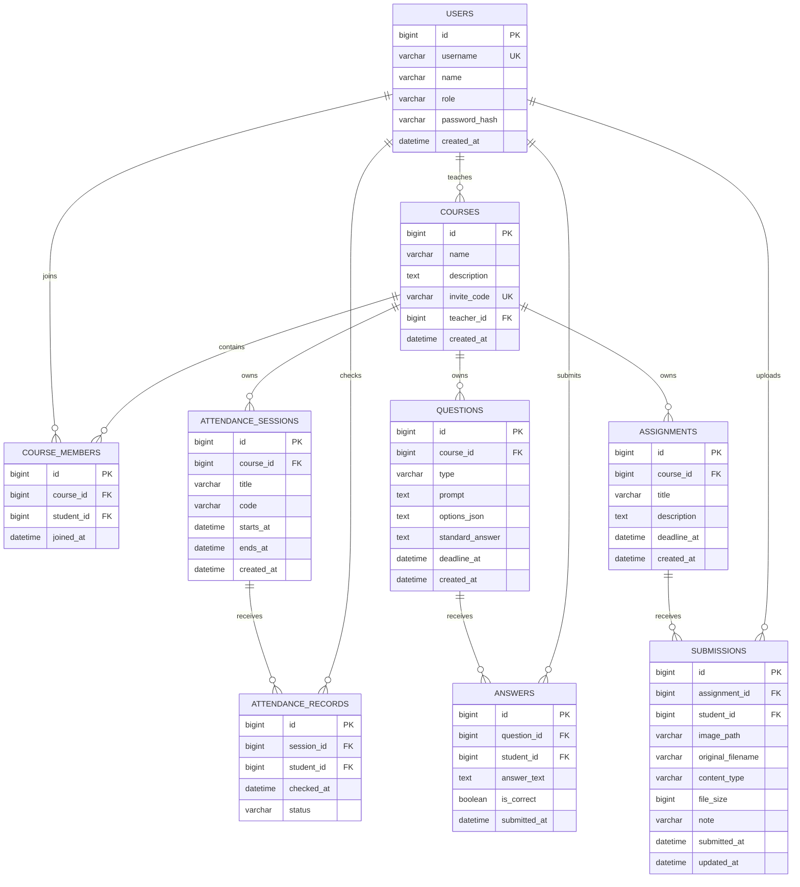

# 数据库设计

## 1. 设计原则

- MySQL 8.4+，字符集 `utf8mb4`，排序规则 `utf8mb4_unicode_ci`。
- 所有时间字段统一 `DATETIME(6)` 并以 **UTC** 写入；客户端按设备时区展示。
- 主键使用 `BIGINT AUTO_INCREMENT`；外键保证关联完整性；组合唯一约束保证业务去重。
- 表结构通过 Flyway 管理；当前版本 `V1__initial_schema.sql`。
- 作业图片存服务器本地目录，数据库仅保存相对路径和元信息；不把二进制写入 MySQL。
- 统计一律实时 `COUNT`/聚合查询，不设预计算统计表，避免预计算数据与图表不一致。

## 2. E-R 图



## 3. 表结构

### 3.1 `users`

| 字段 | 类型 | 约束 | 说明 |
| --- | --- | --- | --- |
| id | BIGINT | PK, AUTO_INCREMENT | 用户 ID |
| username | VARCHAR(40) | NOT NULL, UNIQUE | 学号/工号，登录账号 |
| name | VARCHAR(60) | NOT NULL | 姓名 |
| role | VARCHAR(16) | NOT NULL, CHECK | `STUDENT` / `TEACHER` |
| password_hash | VARCHAR(100) | NOT NULL | BCrypt 哈希 |
| created_at | DATETIME(6) | NOT NULL | UTC 创建时间 |

索引：`uk_users_username(username)`。

### 3.2 `courses`

| 字段 | 类型 | 约束 | 说明 |
| --- | --- | --- | --- |
| id | BIGINT | PK | 课程 ID |
| name | VARCHAR(120) | NOT NULL | 课程名称 |
| description | TEXT | NOT NULL | 课程简介 |
| invite_code | VARCHAR(12) | NOT NULL, UNIQUE | 7 位大写邀请码 |
| teacher_id | BIGINT | FK → users.id | 创建教师 |
| created_at | DATETIME(6) | NOT NULL | UTC 创建时间 |

索引：`uk_courses_invite_code`、`idx_courses_teacher`。教师只能查询 `teacher_id = 当前用户` 的课程。

### 3.3 `course_members`

| 字段 | 类型 | 约束 | 说明 |
| --- | --- | --- | --- |
| id | BIGINT | PK | 成员记录 ID |
| course_id | BIGINT | FK → courses.id | 课程 |
| student_id | BIGINT | FK → users.id | 学生 |
| joined_at | DATETIME(6) | NOT NULL | 加入时间 |

约束：`UNIQUE(course_id, student_id)`，同一学生不能重复加入同一课程。索引 `idx_members_student(student_id)`。

### 3.4 `attendance_sessions`

| 字段 | 类型 | 约束 | 说明 |
| --- | --- | --- | --- |
| id | BIGINT | PK | 签到活动 |
| course_id | BIGINT | FK → courses.id | 所属课程 |
| title | VARCHAR(160) | NOT NULL | 签到标题 |
| code | VARCHAR(12) | NOT NULL | 6 位随机签到码 |
| starts_at | DATETIME(6) | NOT NULL | 开始时间 |
| ends_at | DATETIME(6) | NOT NULL | 截止时间 |
| created_at | DATETIME(6) | NOT NULL | 创建时间 |

索引：`idx_attendance_course(course_id, starts_at)`。

### 3.5 `attendance_records`

| 字段 | 类型 | 约束 | 说明 |
| --- | --- | --- | --- |
| id | BIGINT | PK | 签到记录 |
| session_id | BIGINT | FK → attendance_sessions.id | 签到活动 |
| student_id | BIGINT | FK → users.id | 学生 |
| checked_at | DATETIME(6) | NOT NULL | 实际签到时间 |
| status | VARCHAR(16) | NOT NULL | `PRESENT` |

约束：`UNIQUE(session_id, student_id)`。索引 `idx_attendance_records_student(student_id)`。

### 3.6 `questions`

| 字段 | 类型 | 约束 | 说明 |
| --- | --- | --- | --- |
| id | BIGINT | PK | 题目 ID |
| course_id | BIGINT | FK → courses.id | 所属课程 |
| type | VARCHAR(24) | NOT NULL, CHECK | `SINGLE_CHOICE` / `FILL_BLANK` |
| prompt | TEXT | NOT NULL | 题干 |
| options_json | TEXT | NULL | 选择题选项 JSON 数组；填空题为 NULL |
| standard_answer | TEXT | NOT NULL | 选项键或填空标准答案 |
| deadline_at | DATETIME(6) | NOT NULL | 作答截止时间 |
| created_at | DATETIME(6) | NOT NULL | 创建时间 |

索引：`idx_questions_course(course_id, created_at)`。`options_json` 示例：

```json
[{"key":"A","text":"先进先出"},{"key":"B","text":"后进先出"}]
```

### 3.7 `answers`

| 字段 | 类型 | 约束 | 说明 |
| --- | --- | --- | --- |
| id | BIGINT | PK | 作答记录 |
| question_id | BIGINT | FK → questions.id | 题目 |
| student_id | BIGINT | FK → users.id | 学生 |
| answer_text | TEXT | NOT NULL | 规范化后的答案 |
| is_correct | BOOLEAN | NOT NULL | 自动判分结果 |
| submitted_at | DATETIME(6) | NOT NULL | 提交时间 |

约束：`UNIQUE(question_id, student_id)`，每题一次。索引 `idx_answers_student(student_id)`。

### 3.8 `assignments`

| 字段 | 类型 | 约束 | 说明 |
| --- | --- | --- | --- |
| id | BIGINT | PK | 作业 ID |
| course_id | BIGINT | FK → courses.id | 所属课程 |
| title | VARCHAR(160) | NOT NULL | 标题 |
| description | TEXT | NOT NULL | 说明 |
| deadline_at | DATETIME(6) | NOT NULL | 截止时间 |
| created_at | DATETIME(6) | NOT NULL | 创建时间 |

索引：`idx_assignments_course(course_id, created_at)`。

### 3.9 `submissions`

| 字段 | 类型 | 约束 | 说明 |
| --- | --- | --- | --- |
| id | BIGINT | PK | 提交 ID |
| assignment_id | BIGINT | FK → assignments.id | 作业 |
| student_id | BIGINT | FK → users.id | 学生 |
| image_path | VARCHAR(255) | NOT NULL | 相对 uploads 的路径 |
| original_filename | VARCHAR(255) | NOT NULL | 原文件名（仅元数据） |
| content_type | VARCHAR(64) | NOT NULL | `image/jpeg` / `image/png` |
| file_size | BIGINT | NOT NULL | 字节数 |
| note | VARCHAR(500) | NULL | 可选说明 |
| submitted_at | DATETIME(6) | NOT NULL | 首次提交时间 |
| updated_at | DATETIME(6) | NOT NULL | 最近替换时间 |

约束：`UNIQUE(assignment_id, student_id)`，每名学生每项作业一条记录。索引 `idx_submissions_student(student_id)`。

## 4. 关键 SQL 操作与统计查询

### 4.1 课程成员数

```sql
SELECT COUNT(*) FROM course_members WHERE course_id = ?;
```

### 4.2 每次签到应到/实到

```sql
SELECT s.id, s.title, s.starts_at,
       (SELECT COUNT(*) FROM course_members m WHERE m.course_id = s.course_id) AS expected,
       (SELECT COUNT(*) FROM attendance_records r WHERE r.session_id = s.id) AS present
FROM attendance_sessions s
WHERE s.course_id = ?
ORDER BY s.starts_at;
```

### 4.3 每题提交人数与正确人数

```sql
SELECT q.id, q.prompt,
       COUNT(a.id) AS submissions,
       COALESCE(SUM(a.is_correct), 0) AS correct
FROM questions q
LEFT JOIN answers a ON a.question_id = q.id
WHERE q.course_id = ?
GROUP BY q.id, q.prompt;
```

正确率 = `correct / submissions`，**分母是实际作答人数**；提交为 0 时返回 0%。

### 4.4 每项作业提交人数

```sql
SELECT a.id, a.title,
       (SELECT COUNT(*) FROM submissions s WHERE s.assignment_id = a.id) AS submitted,
       (SELECT COUNT(*) FROM course_members m WHERE m.course_id = a.course_id) AS expected
FROM assignments a
WHERE a.course_id = ?;
```

## 5. 数据完整性与并发

- `(course_id, student_id)`、`(session_id, student_id)`、`(question_id, student_id)`、`(assignment_id, student_id)` 唯一约束是第一道并发防线。
- 业务层先做存在性检查，数据库唯一约束兜底；并发重复请求会由 `DataIntegrityViolationException` 映射为 409 `CONFLICT`，不会产生重复行。
- 作业替换：先写随机新文件 → 更新提交记录 → 事务提交成功后删除旧文件；事务回滚时删除新文件。同一学生的并发替换通过用户行悲观锁串行化。
- 文件路径解析使用 `root.resolve(relative).normalize()` 并校验 `startsWith(root)`，阻止 `../` 路径穿越。

## 6. 迁移与测试数据

- 迁移文件：`backend/src/main/resources/db/migration/V1__initial_schema.sql`、`V2__multiple_choice.sql`（扩展题型检查约束）。
- Flyway 在应用启动时执行，`ddl-auto=validate` 保证实体与真实表结构一致。
- 测试使用独立 H2 数据库和临时上传目录；测试运行时自行创建教师、学生、课程和活动。
- 仓库不包含预置课程、账号或作业图片。

## 7. 备份与保留

- 生产备份：`scripts/backup.sh` 同时导出 MySQL 与 `/data/uploads`，保留 30 天。
- 数据库备份使用 `mysqldump --single-transaction --routines --triggers`。
- 恢复顺序：先恢复 MySQL，再恢复 uploads；两者时间点需一致，否则可能出现数据库有记录但图片缺失。恢复步骤见部署文档。


