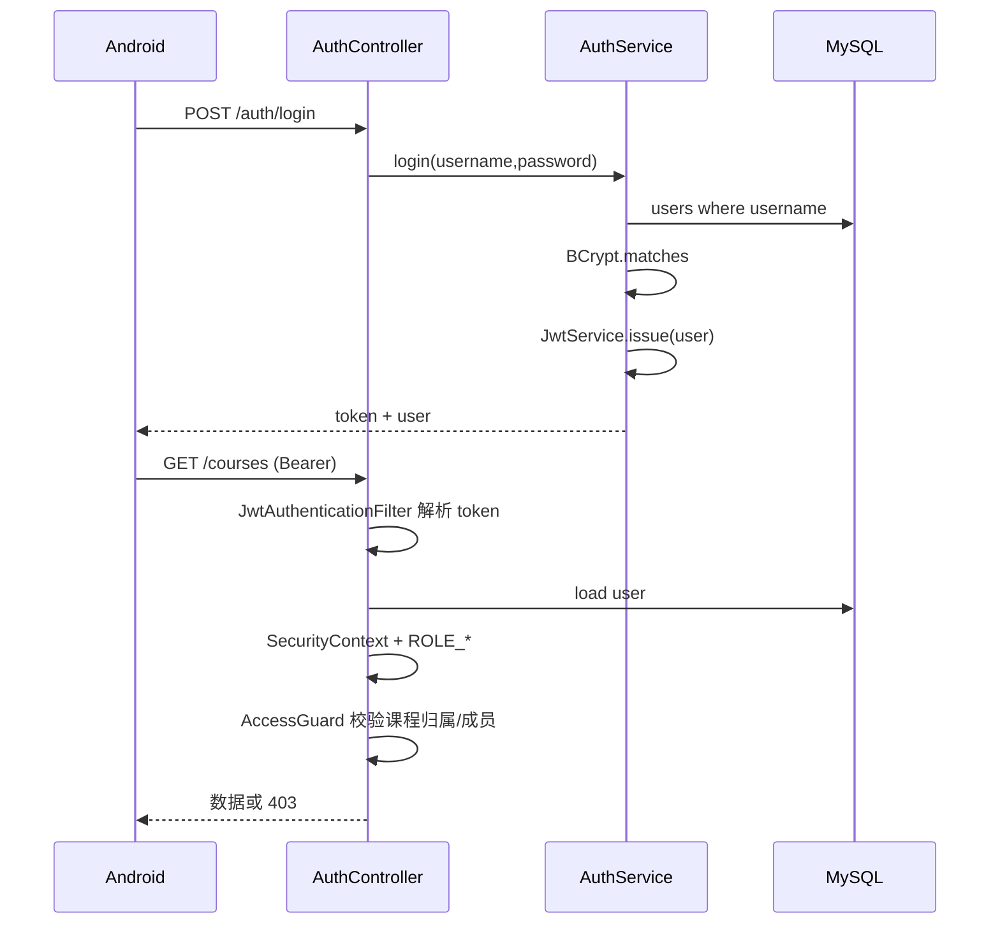
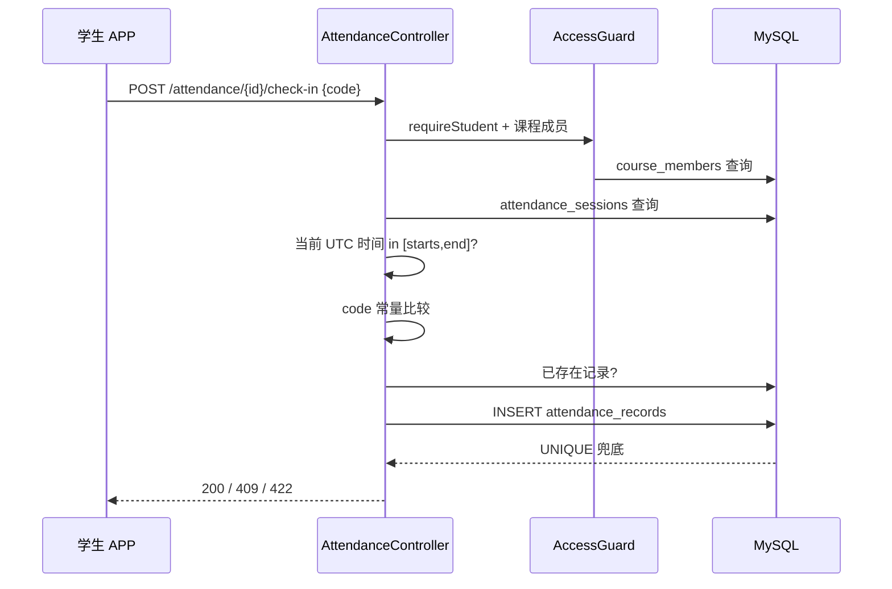
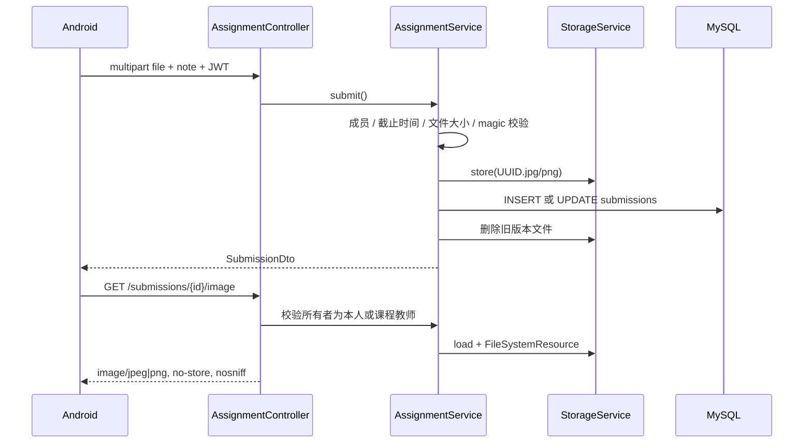

# 开发方案与实现说明

## 1. 需求到实现的映射

| 方案要求 | 实现位置 |
| --- | --- |
| Android Kotlin + Compose + ViewModel + Retrofit + DataStore | `android/app/src/main/java/com/classpulse/app/` |
| Spring Boot + Spring Security + JPA | `backend/src/main/kotlin/com/classpulse/` |
| MySQL + 迁移工具 | Flyway `V1__initial_schema.sql` |
| 本地图片存储 + MySQL 路径 | `StorageService` + `submissions.image_path` |
| Nginx + HTTPS + Docker Compose | `deploy/` |
| 学生/教师权限 | `AccessGuard`、`SecurityConfig`、课程归属查询 |
| 课程邀请码 | `CourseService.generateInviteCode()` + DB 唯一索引 |
| 签到码/有效期/防重复 | `AttendanceService` + `UNIQUE(session_id, student_id)` |
| 单选/多选/填空自动判分 | `QuestionService` |
| 拍照/相册与单图替换 | Android Activity Result + `AssignmentService.submit` |
| 图片权限 | `AssignmentService.image` |
| 图表 | `StatsContent.kt` 自绘 Compose 图表 |
| 文档/测试/脚本 | `docs/`、`scripts/`、源码测试目录 |

## 2. 总体架构

```text
┌──────────────────────────────────────────────────────────────┐
│ Android (Kotlin / Compose)                                   │
│  Auth / Home / Course / Stats                                │
│      │ ViewModel StateFlow                                   │
│      ▼                                                       │
│  ClassroomRepository ── Retrofit + OkHttp (Bearer)           │
│      │                         │                             │
│  DataStore (token/server)      │ Coil (鉴权图片)              │
└──────┼─────────────────────────┼─────────────────────────────┘
       │ HTTPS JSON / multipart  │ GET image + JWT
       ▼                         ▼
┌──────────────────────────────────────────────────────────────┐
│ Nginx 443: TLS, HSTS, rate limit, body limit, proxy          │
└───────────────────────────┬──────────────────────────────────┘
                            ▼
┌──────────────────────────────────────────────────────────────┐
│ Spring Boot                                                  │
│  Controller → Service → Repository                           │
│  JWT Filter → SecurityContext → AccessGuard                  │
│  GlobalExceptionHandler → ApiResponse envelope               │
│  StorageService → UPLOAD_DIR                                 │
└───────────────┬───────────────────────────────┬──────────────┘
                ▼                               ▼
          MySQL 8.4+                    local uploads volume
```

## 3. 后端实现

### 3.1 分层

- `web`：Controller、DTO、统一响应、异常处理。
- `service`：业务规则、事务、聚合和文件存储。
- `repository`：Spring Data JPA。
- `domain`：9 个实体和枚举。
- `security`：JWT 签发/解析、过滤器、`UserPrincipal`。
- `config`：安全配置、配置属性。

### 3.2 认证与授权



- 密码：BCrypt strength 12。
- JWT：HS256；secret 从 `JWT_SECRET` 注入；prod 缺失即启动失败。
- 令牌默认 168 小时；Android 401 时自动清理 DataStore。
- 服务端从不信任客户端传来的角色；角色来自数据库。
- 每个课程资源都通过 `AccessGuard.teacherCourse/studentCourse/readableCourse` 校验。
- 教师不开放注册：首次部署用一次性 `BOOTSTRAP_TEACHER_*` 创建首个教师，之后移除密码变量。

### 3.3 签到顺序



关键点：先校验身份和成员，再验证有效期和码，最后写入；唯一键防并发重复。

### 3.4 自动判分

- 选择题答案规范化：`trim().uppercase(Locale.ROOT)`；多选题按逗号拆分、去重并按选项顺序拼接，选项集合与标准答案完全一致才计分。
- 填空题：`trim().equals(standardAnswer.trim(), ignoreCase = true)`。
- 不使用语义模型；不同表述即使语义相同也会判错，符合方案范围。
- 学生未作答时不返回标准答案；作答后返回。

### 3.5 文件上传



- 支持 JPEG（FF D8 FF）和 PNG（89 50 4E 47 0D 0A 1A 0A）。
- 文件名 `UUID`；原文件名只用于下载元信息。
- 文件路径相对 `uploads`，解析时防止 `..` 穿越。
- 替换只保留最新版本；数据库唯一约束使同一学生同一作业只有一行。

### 3.6 统计

`StatsService` 在事务内以课程为单位聚合：

- 签到：每次签到 `presentCount = COUNT(attendance_records)`、`expected = COUNT(course_members)`、`rate = present / expected`。
- 问答：每题 `submissions = COUNT(answers)`、`correct = SUM(is_correct)`、`rate = correct / submissions`。
- 作业：`submitted = COUNT(submissions)`、`expected = memberCount`、`rate = submitted / expected`。
- 总体：对有数据的模块平均值等权；问答只对已有作答的题目取算术平均，无人作答题目不参与。
- 结论由实际最低项、总量和分母动态拼接；前端只展示，不计算结论。

## 4. Android 实现

### 4.1 模块

```text
app/
├── data/
│   ├── model/Models.kt         Retrofit DTO
│   ├── api/ClassroomApi.kt     API 定义
│   ├── api/ApiProvider.kt      动态 baseUrl + JWT interceptor
│   ├── ClassroomRepository.kt  envelope/错误统一处理
│   └── SessionManager.kt       DataStore token/user/server
├── ui/
│   ├── AppRoot.kt              启动状态 + Navigation
│   ├── AppViewModel.kt         会话恢复
│   ├── auth/                   登录注册 VM
│   ├── courses/                课程列表 VM
│   ├── course/                 课程详情/业务 VM
│   ├── components/             品牌组件、输入、卡片、状态
│   ├── screens/                Compose 页面
│   ├── theme/                  颜色、排版、形状
│   └── util/Formats.kt         时区、百分比、文件大小
├── ClassPulseApplication.kt    依赖容器 + Coil 图片加载器
└── MainActivity.kt
```

### 4.2 会话与服务器地址

- `DataStore Preferences` 保存 token、用户 JSON、服务器 URL。
- JWT 包含用户 `authVersion`；修改/重置密码会递增该值，旧令牌立即失效。本人改密后服务端返回新令牌，当前设备保持登录。
- 启动：恢复 token → `GET /auth/me` 验真。401 清除会话；网络异常保留本地会话，避免因断网强制退出。
- Debug 构建的登录页提供开发用“服务器设置”；Release 构建隐藏地址和入口，只使用构建时注入的 HTTPS 地址。`ApiProvider` 在地址变化时重建 Retrofit。
- 图片加载器使用独立 OkHttp，自动追加 `Authorization`，因此 Coil 能加载受保护图片。
- Debug 构建默认 `http://10.0.2.2:8080/`，仅 Debug 清单允许明文；Release 禁止明文。

### 4.3 状态管理

- 每个业务页一个 `ViewModel`，`StateFlow` 保存 UI 状态，`collectAsStateWithLifecycle()` 收集。
- 加载、空数据、错误、忙碌四态在 UI 中显式展示。
- 底部面板状态与列表数据同在一个 `CourseUiState`，避免跨组件临时状态丢失。
- 所有写操作通过回调返回 `String?` 错误：成功关闭弹窗并刷新，失败保留弹窗显示错误。

### 4.4 拍照/相册

- 相册：`ActivityResultContracts.GetContent("image/*")`。
- 相机：`ActivityResultContracts.TakePicture()` + `FileProvider` 临时文件，不申请 CAMERA 权限（使用系统相机）。
- 选择后立即预览；提交前在 IO 线程读取文件并检查字节签名与 10 MB。
- 后端仍做二次校验，客户端校验只用于体验。

### 4.5 图表

不引入第三方图表库，使用 Compose 布局/Canvas 自绘：

- 综合环形图：Canvas `drawArc`。
- 签到柱状图：Canvas 圆角柱 + 网格线 + 底部图例。
- 问答/作业：自绘进度条与标签。
- 所有数值来自 `/courses/{id}/stats`，不使用本地硬编码。
- 统计页展示口径说明，避免只给数字不解释分母。

### 4.6 视觉与交互

- 品牌色墨绿/纸张色，衬线标题与无衬线正文。
- 登录页脉冲曲线、首页深色 hero、课程卡编号和邀请码票券。
- 按钮和输入框 14–18 dp 圆角；底部面板、全屏图片预览。
- 输入错误即时提示，提交期间全屏遮罩，避免重复点击。
- 空状态给出下一步操作（创建/加入/发布），不是仅显示“暂无数据”。

## 5. 安全设计

| 风险 | 措施 |
| --- | --- |
| 明文密码 | BCrypt 哈希，DTO 不回传哈希 |
| 越权访问课程 | 每个接口的课程归属/成员检查 |
| 越权查看图片 | 所有者或课程教师才是合法读者 |
| 上传非图片 | 魔数校验，不只信 MIME/扩展名 |
| 路径穿越 | 规范化路径 + `startsWith(root)` |
| 重放/重复签到 | 唯一约束 + 业务先检查 |
| SQL 注入 | Spring Data JPA 参数化查询 |
| JWT 泄漏 | HTTPS，Nginx HSTS，令牌只存本机 DataStore，日志不记录 body |
| 暴力登录 | Nginx 限流；可进一步加账号锁定/验证码 |
| 备份泄漏 | 备份文件权限和异地加密存储由运维配置 |

## 6. 错误处理与可观测性

- 统一 `{success,data,message,code,timestamp}`；业务错误用稳定 code，便于客户端提示和测试。
- `GlobalExceptionHandler` 对验证、认证、权限、上传、数据库冲突、未知异常分别映射。
- 服务端日志记录异常堆栈，但响应不返回堆栈。
- Actuator health 供 Docker healthcheck；Nginx 不对外暴露 actuator。
- 前端错误 `ApiFailure(code,message)`，网络/超时使用中文可操作提示。

## 7. 时间与数据一致性

- 所有业务时间以 `Instant` 进入后端，MySQL `DATETIME(6)` 存 UTC。
- 客户端 `Formats` 用 `ZoneId.systemDefault()` 展示。
- 截止判断只在服务端；客户端时间仅用于界面状态。
- 统计分母说明：
  - 签到/作业：课程成员数；
  - 问答：实际提交人数。
- 课程成员变动会影响历史签到/作业分母，这是“当前课程成员数”口径；如未来需要快照口径，可增加活动目标名单表。

## 8. 部署与交付

- `backend/Dockerfile` 多阶段构建；
- `deploy/docker-compose.yml` MySQL + backend + Nginx；
- `deploy/nginx/default.conf.template` HTTPS、安全头、限流、`client_max_body_size`；
- `scripts/deploy.sh`、`backup.sh`、`new-local-env.ps1`、`build-all.ps1`；
- 文档覆盖需求、ER、API、部署和实现说明。

## 9. 管理员后台

- 管理员使用独立的 `admin_users` 表和 `admin_sessions` 表，不共享教师/学生 JWT。
- 会话 Cookie 为 HttpOnly、SameSite=Lax，生产环境带 Secure；所有写请求额外校验 `X-CSRF-Token`。
- 管理接口位于 `/api/admin/**`，教师和学生令牌无法访问；登录失败按 IP 与账号限速。
- 课程、账号和提交使用版本字段，后台提交时若版本已变化返回 409，要求重新核对。
- 永久删除先做影响统计和课程名称确认，事务提交成功后再删除上传图片。
- 管理页面为静态 HTML/CSS/JS，由 Spring Boot 直接提供；页面可见时每 5 秒刷新，编辑表单和确认框会暂停自动刷新。

## 10. 已知限制与后续演进

1. 签到无定位/人脸，只能证明持码，不宣称完全防代签。
2. 图片存储为本地卷；多实例部署应改用 S3/OSS，并把访问控制保留在后端。
3. 无多图、草稿、推送和 WebSocket 实时推送；课堂页面、首页课程列表以及当前打开的签到/答题/作业明细采用 5 秒自动刷新，轮询在 `RESUMED` 生命周期内运行，并使用单飞取消避免旧响应覆盖新数据。作业评分与评语已支持。
4. 统计按当前成员数；如需历史名单口径，增加活动成员快照。
5. 无短信/邮件找回；学生忘记密码由课程教师生成临时密码，教师本人可自助修改密码。生产可接入学校统一身份认证。
6. 反向代理可使用 Nginx 或 Caddy；两者只替换 TLS 入口，后端权限和图片流逻辑不变。


